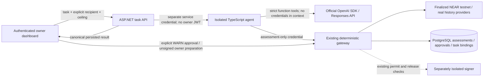

# Milestone 3 — bounded real-provider payment agent

Implemented on 2026-11-03. The TypeScript agent, API integration, PostgreSQL audit
claims, dashboard review flow and deterministic verification are implemented.
**Live OpenAI verification remains blocked by this tool session's environment.**
No contract/key changes, signing, dispatch or NEAR transactions were performed.
The existing restricted-key and deployed-expiry-guard release blockers remain.

## Architecture



The provider boundary is `src/sentinel-agent-client/src/provider.mjs` and
`providers/openai/runtime.mjs`. The latter imports **the official `openai` SDK**,
pinned to 6.0.0 in a separate provider package. Provider/model/key configuration
comes from process environment; there is no fake-provider production mode or
automatic fallback. Model selection is explicit through `OPENAI_MODEL`.
The adapter follows the official [Responses function-calling protocol](https://developers.openai.com/api/docs/guides/function-calling),
including function-call IDs and reasoning continuation items. Requests use
`store:false`, encrypted reasoning continuation, strict tools, no parallel tool
calls, no SDK retries, a 30-second SDK timeout and 1,200 output tokens per call.
`store:false` is an API setting, not a claim of zero provider-side retention.

The agent process has only a model credential, a runner service credential and an
assessment-only gateway credential. No owner JWT, human approval ID/token, worker
credential, NEAR private key or signing API is passed to the process or model.
The frontend holds its existing owner session, never model/service credentials.

## Workflow and constraints

The owner enters natural-language task text plus **separate explicit recipient
and amount-ceiling fields**. Those fields are hard constraints; task/invoice text
cannot add recipients or enlarge the ceiling. This milestone allows one proposed
payment per task. It does not infer spending authority from task wording.

The model tools are:

1. `read_spending_policy({})` — current structured limits, usage and balance.
2. `inspect_recipient({recipient})` — the one selected supported recipient.
3. `propose_payment({recipient,amountYocto,purpose})` — only after policy and
   recipient inspection, once per task, bounded by the task ceiling, per-payment
   maximum, available balance and remaining daily authorization/execution quotas.
   Expiry is generated by the application, not the model, at 15 minutes.
4. `assess_payment({proposalId})` — the application resolves the stored proposal
   and calls the independent gateway. The model cannot supply decision, risk,
   approval or transaction fields.

Unknown fields, tools, malformed arguments, replayed call IDs, parallel calls,
unsupported recipients and excessive amounts fail closed. The loop allows at
most six model turns/eight tool calls, with a hard 90-second deadline and bounded
task/argument/response sizes. Actual successful flows use four calls. The runner
allows two concurrent tasks and retains up to 1,000 task claims per process;
capacity exhaustion denies new work. API run claims persist across restarts.

After assessment, the agent retrieves the canonical assessment again and stops
without a further model turn. ALLOW means **owner authorization required**, WARN
means **human approval required**, BLOCK means **refused**. The model cannot
reinterpret these statuses or supply authoritative explanatory text.

The task API claims a GUID run ID in PostgreSQL before invoking the runner. The
gateway validates the persisted task constraints when it receives
`X-Sentinel-Agent-Run`, and binds one assessment to that run with a deterministic
unique audit-event key. The task API requires that binding and reloads the actual
assessment. A forged runner ALLOW flag, forged approval, unknown assessment or
older valid assessment from another run cannot substitute for the result. Replayed
run IDs return 409 without a new model call. Failed/ambiguous tasks remain claimed;
there is no automatic retry that could repeat a model workflow.

Task text, documents, website text, purpose and model/tool responses are treated as
untrusted. No arbitrary URL retrieval, document execution, shell/code execution,
MCP tools or dynamic tool installation is exposed. Only bounded structured fields
are forwarded from recipient/policy context; injected extra narrative is discarded.
These runtime constraints remain effective when the model itself is adversarial.
Fixture tests establish those constraints, not real-model prompt-injection quality.

## Dashboard and preserved authorization boundary

The new **AI payment agent** panel provides task, selected recipient, NEAR ceiling,
canonical proposed amount/purpose, ALLOW/WARN/BLOCK, evidence and expiry. WARN uses
an explicit owner confirmation checkbox and the existing authenticated approve
endpoint. Preparing the unsigned owner authorization revalidates the assessment,
exact intent and approval through the Milestone 2 gateway. Expired references are
disabled in the UI and rejected by the server. Changing task constraints clears
the displayed assessment/approval/preparation.

The new flow stops at an unsigned owner authorization descriptor. It deliberately
does not sign or dispatch. Existing on-chain owner authorization and subsequent
execution-stage WARN approval, release attestation and one-use signing permit
remain mandatory. This feature adds no autonomous spending authority. A future
live signing/dispatch UI change needs separate review after the release blockers
are resolved. Existing dashboard features remain available.

Owner-only task endpoints use strict JSON, an 8 KB request limit and the existing
gateway rate limiter. Runner calls use a separate credential; redirects are
disabled, HTTP is permitted only for loopback, and responses are capped at 64 KB.
Gateway context is finalized real testnet data; critical failures deny. Risk
thresholds, approval lifetimes and existing contract/signing enforcement are
unchanged. See [the API contract](milestone-3-contract.md).

## Persistence and logs

No new migration is needed: existing audit events store durable run claims,
sanitized status, explicit ceiling/recipient, task SHA-256, the canonical result
and unique assessment bindings. Existing assessment/blocklist/approval/permit
tables retain their responsibilities. Natural-language task text and model
reasoning/raw responses are not written to application audit logs. Payment
purpose is intentionally persisted as untrusted intent data for human review.
Runner JSON logs contain only controlled event/tool/code, run ID, assessment ID
and timestamp. Upstream response bodies and exception details are not logged or
returned by the runner/provider. Credentials are never included in model input.

All verification used fresh isolated PostgreSQL schemas. Existing application
tables/configuration were not migrated, overwritten or reset.

## Reproduction and verification

Run the local suite from the repository root:

```powershell
powershell -NoProfile -ExecutionPolicy Bypass -File tests/run-milestone3.ps1
```

It includes the complete prior suite, agent typechecking, both frontend builds,
the new agent/adversarial HTTP tests and the explicit fixture demo. The .NET
end-to-end test starts the real TypeScript HTTP runner and real gateway/API against
isolated PostgreSQL, substituting only model and NEAR/index dependency responses.
It exercises ALLOW, WARN approval/preparation and BLOCK refusal, task ceilings,
unsupported recipients, strict authentication, durable replay denial and forged
runner substitution of an older valid assessment.

| Check | Result |
| --- | --- |
| .NET unit tests | 40 pass |
| .NET integration tests, including PostgreSQL + TypeScript runner | 12 pass, none skipped |
| Existing signer tests | 25 pass |
| Agent/client/provider-contract/HTTP/adversarial tests | 34 pass |
| Existing read-only diagnostic logic | 18 pass |
| Existing Rust contract tests | 10 pass |
| Agent TypeScript check; API, dashboard and auth-client builds | Pass |
| Explicit deterministic ALLOW/WARN/BLOCK demo | Pass |
| Official SDK download / actual SDK transport / real-model smoke | Blocked; not claimed as passed |

There are **139 distinct passing tests**. Coverage includes injected payment
instructions, malicious recipients, unauthorized tools/extra fields, forged
approvals/responses, excessive task and daily spending, repeated proposals,
WARN bypass, BLOCK prevention at signing, tool/task/permit replay, timeouts,
iteration caps, malformed/oversized context and sanitized failure paths.
Evidence is in `.test-artifacts/milestone3-verified.log` and
`.test-artifacts/milestone3-agent.log`. UI integration is build-verified; an
interactive browser session against a real model remains unverified.

### Real provider and demos

From `src/sentinel-agent-client/providers/openai`, run
`npm install --ignore-scripts` on a network-enabled machine, then return to
`src/sentinel-agent-client`. The exact SDK version is pinned; installation must
generate/review the provider lockfile before release. This session could not
download the SDK, so no fabricated dependency tree/lockfile is committed.

Configure these process environment variables in the process that starts the
agent (see `.env.example`, which contains names/placeholders only):

- `OPENAI_API_KEY`, `OPENAI_MODEL`, `SENTINEL_AGENT_PROVIDER=openai`.
- `SENTINEL_API_URL` (HTTPS), `SENTINEL_AGENT_API_KEY` matching API
  `AgentGateway:ApiKey`.
- `SENTINEL_RUNNER_KEY` matching API `AgentRunner:ApiKey`, optional
  `SENTINEL_AGENT_PORT` (8021 by default).
- API `AgentRunner:Url` points to the loopback runner base URL.

No credentials are created by this milestone. `.env` files are not automatically
loaded; environment changes in a separate terminal do not update this tool
process. Do not paste credentials into prompts/chat or VITE/browser variables.

```powershell
npm run smoke:real
npm run demo:fixture
```

`smoke:real` performs exactly one minimal tool call, without a gateway or NEAR
client. `demo:fixture` makes no external calls. For a full real-model assessment
only, set `SENTINEL_DEMO_RECIPIENT`, `SENTINEL_DEMO_MAX_YOCTO`, optionally
`SENTINEL_DEMO_TASK`, and run `npm run demo:real`. That CLI has no owner task claim
and cannot substitute its assessment into a dashboard run; it uses the existing
assessment-only gateway API. `npm start` starts the real dashboard runner.

The user reported setting the key locally, but repeated safe presence checks
showed it absent from this tool process and Windows user/machine environment.
No value was printed. npm install and unauthenticated OpenAI connectivity probes
still returned EACCES/network access denied. The minimal smoke script consequently
failed its configuration preflight; no real-model request was sent. No model was
silently substituted. `OPENAI_MODEL` is also not configured in this tool process.

Postman is signed out/uninitialized and cannot access its local storage; Orbit and
npm are unreachable here. Tests use the repository's local Node fixture fallback;
no Postman-hosted run/publication is claimed. Existing NuGet vulnerability-feed
warnings and upstream wallet bundle/eval warnings remain environmental/build
limitations, not passing vulnerability audits.

## Mandatory blockers and remaining reviews

1. Install/lock the official SDK and run the minimal real-model smoke plus full
   real-provider assessment demo from an environment with the key, explicit model
   and network access. These live results remain unverified.
2. Provisioning the missing restricted agent key and deploying the current
   24-hour authorization-expiry guard remain separately approved release work.
   Neither was performed or bypassed.
3. Existing Milestone 2 migration/configuration rollout and fresh live testnet
   prerequisite verification remain necessary before any payment. No signing or
   submission approval has been received.

The initial one-recipient/one-proposal scope and fixed task ceilings are deliberate
product constraints. Provider data-handling/model choice, service-secret isolation,
network ACLs and project model-spend limits need deployment review. The gateway
remains the spending authority; LLM/provider reliability affects task completion,
not approval or signing authority. Off-chain risk-to-inclusion races and trusted
RPC/database/signer assumptions remain as documented in [Milestone 2](milestone-2.md).
